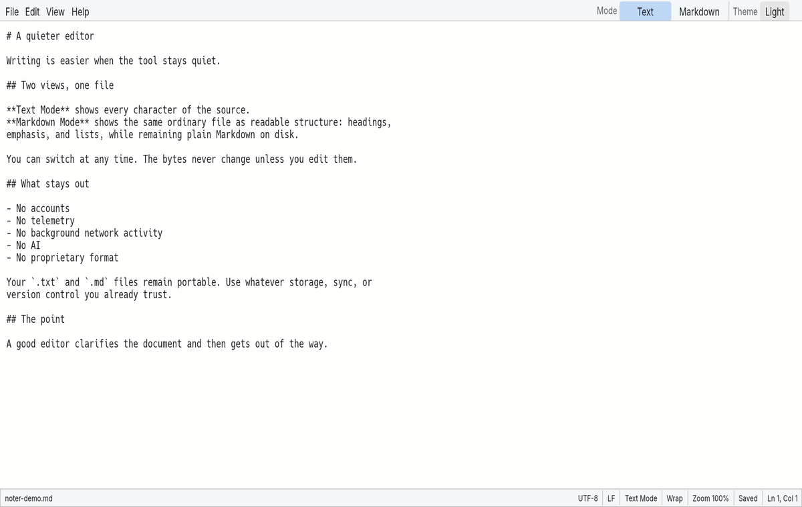
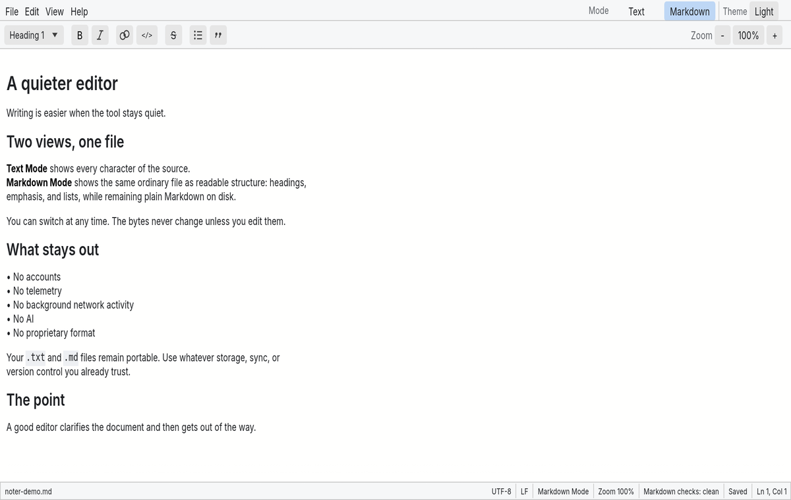
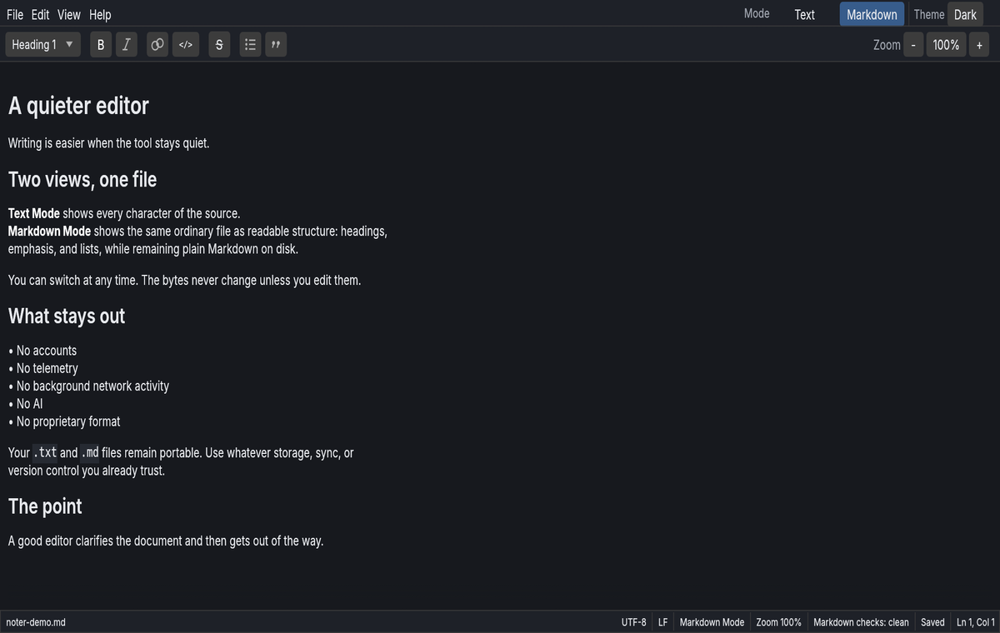
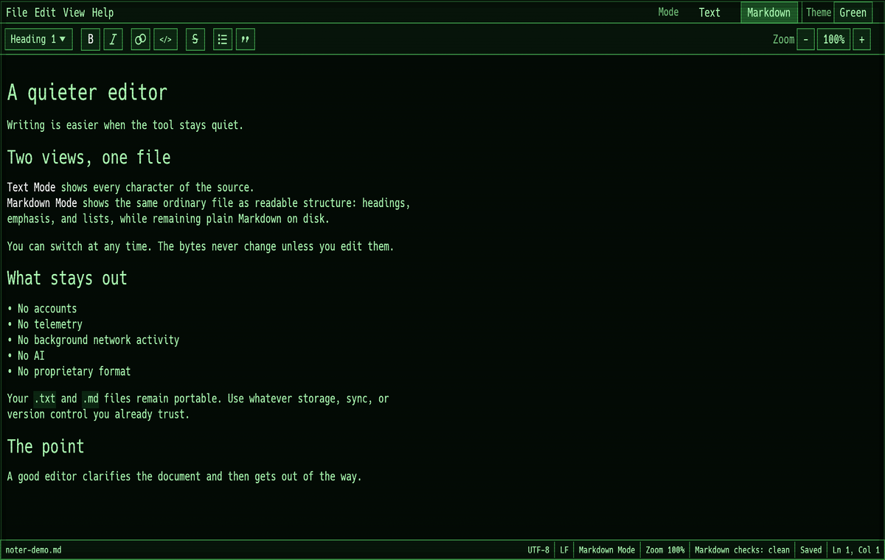
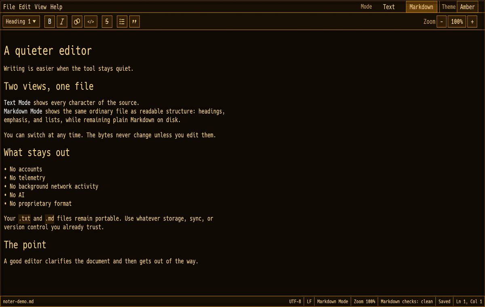

# Noter

[](https://github.com/blisspixel/noter/actions/workflows/ci.yml)
[](https://github.com/blisspixel/noter/releases)
[](LICENSE)

**A clean, private, buttery-smooth text and Markdown editor. Nothing else.**

Privacy first. Zero spyware. Zero telemetry. Zero activity logging. No analytics
panel, no usage funnel, no silent crash phone-home, no background history of
what you wrote or which files you opened. Noter is only the tool you asked for:
open a file, write, save. The rest is deliberately not there.

Noter is a local, cross-platform editor for plain text and Markdown. Use it for
notes, drafts, journals, fiction, arguments, code comments, anything you need
to put into words. Write freely. No account, no feed, no product that studies
you while you work. Freedom of creativity and freedom of speech both need
software that does not second-guess, score, or siphon the work.

Your files stay ordinary portable `.txt` and `.md` on disk. Noter does not lock
them into a proprietary cloud format, a subscription vault, or a bundled AI
pipeline. You choose how to store, sync, back up, or publish. Local preferences
such as theme, wrap, and zoom are ordinary settings on your machine, not a
dossier.

## Highlights

- **Private by Design:** A compiled native desktop and terminal application. No
  WebView, no browser engine, no background network access, and zero telemetry.
  An idle window sleeps instead of draining battery on continuous repaints.
- **One File, Three Exact Views:**
  - **Text Mode:** UTF-8 byte fidelity, explicit line endings, and exact source
    inspection.
  - **Markdown Mode:** Editable source-backed blocks, formatting commands, and
    document-wide selection. Continuous editing, sticky formatting, and
    caret-aware delimiter reveal remain roadmap work.
  - **Terminal TUI Mode:** A fast, lightweight terminal interface ("Like Nano...
    but better") with dual modern and Nano shortcuts, mouse support, and CRT
    themes (`noter --tui`).
- **Defensive Durability:** Atomic file replacement, BLAKE3 content hashing,
  sibling staging, verified permissions, and owner-restricted crash recovery.
- **Quiet and Responsive:** Native rendering, an idle window that sleeps
  instead of repainting, and a rope-backed document core. The measured
  latency budgets and the virtualized large-file editor (target: 50 MiB) are
  roadmap work; today the window edits files up to 8 MiB.
- **Any Language:** Text in every script is kept byte for byte. The window
  draws scripts beyond Latin, Greek, and Cyrillic with fonts already on your
  computer, loaded only when text needs them. Reordering lines that mix
  left-to-right and right-to-left text is roadmap work. The terminal
  interface measures wide and combining characters and relies on the
  terminal's own layout. Current source has a known
  [RTL accessible-text duplication defect](https://github.com/blisspixel/noter/issues/60)
  under some fallback fonts; assistive-technology caret and selection positions
  can be incorrect for those runs.
- **One Document, Full Focus:** Single-document ergonomics instead of a
  workspace that wants to become a platform.

The full privacy contract is in [docs/PRIVACY.md](docs/PRIVACY.md).

## Interface

### One file, two views

These captures show the identical local file in Text Mode and Markdown Mode.
The source bytes do not change when the view changes.

| Text Mode | Markdown Mode |
| --- | --- |
|  |  |

### Light, dark, and terminal themes

Each theme uses the same native text shaping, source-backed Markdown editor, and
deterministic demo file. Green Screen and Amber Screen are complete CRT phosphor
themes, not simple filters over a generic dark capture. Under the System theme
on Linux, Noter also adapts to session text scale and Omarchy palettes.

| Dark | Green Screen | Amber Screen |
| --- | --- | --- |
|  |  |  |

## Install

### Install a release

[Download beta.2](https://github.com/blisspixel/noter/releases/tag/v0.1.0-beta.2)
for Windows, Linux, and macOS (Intel and Apple Silicon). These commands select
that release; you can also build from source below.
The installer verifies the archive's SHA-256 checksum and installs `noter` for
your user. Download it, read it, then run it:

Windows (PowerShell):

```powershell
Invoke-WebRequest https://raw.githubusercontent.com/blisspixel/noter/v0.1.0-beta.2/scripts/install.ps1 -OutFile install-noter.ps1
powershell -ExecutionPolicy Bypass -File .\install-noter.ps1 -Version 0.1.0-beta.2
```

macOS or Linux:

```sh
curl -fsSLo install-noter.sh https://raw.githubusercontent.com/blisspixel/noter/v0.1.0-beta.2/scripts/install.sh
sh install-noter.sh --version 0.1.0-beta.2
```

It installs to `%LOCALAPPDATA%\Programs\Noter\bin` (added to your user
`PATH`) on Windows and `~/.local/bin` on macOS and Linux. On Linux, it also
installs a desktop entry and icon for system application launchers. `--version`
(`-Version`) picks a release and `--uninstall` (`-Uninstall`) removes it; see
[docs/INSTALLATION.md](docs/INSTALLATION.md).

### Source install

You can also build the locked source checkout with the pinned Rust toolchain:

Windows PowerShell:

```powershell
git clone https://github.com/blisspixel/noter.git
cd noter
.\scripts\install.ps1
```

macOS or Linux:

```sh
git clone https://github.com/blisspixel/noter.git
cd noter
sh scripts/install.sh
```

A source install builds from the local checkout and installs to Cargo's bin
directory (`~/.cargo/bin` on macOS and Linux, `%USERPROFILE%\.cargo\bin` on
Windows, or `$CARGO_INSTALL_ROOT/bin`). On Linux, it also installs the desktop
entry and icon so Noter appears in system application launchers and "Open With"
menus.

Start Noter with `noter [FILE]`, or launch the terminal interface with
`noter --tui [FILE]`. Check version with `noter --version`. Full command-line
and update contracts are documented in [docs/INSTALLATION.md](docs/INSTALLATION.md).

## Project status

**Source version:** `0.1.0-beta.2`

[Beta.2](https://github.com/blisspixel/noter/releases/tag/v0.1.0-beta.2) was
published on 2026-10-11 as a focused hardening prerelease. It fixes beta.1's
terminal save-failure, recovery, and terminal-control defects. The
[publication record](docs/evidence/beta2-publication-2026-10-11.md) identifies
the exact source, passing CI, verified packages, and build provenance.
Keep backups during prerelease use.

Both interfaces share save safety, crash recovery, and bounded Undo. Beta.2 also
adds Linux desktop integration and mitigates hidden-window
Wayland stalls. Native Hyprland retesting remains pending. The virtualized
large-file editor (M5), continuous Markdown editing (M6), and platform signing
and complete distribution evidence (M7) remain open. The
[release readiness record](docs/RELEASE_READINESS.md) separates implementation,
automated evidence, native checks, and deferred checkpoint gates.

The privacy stance above is product law for every release, including alpha. What
is still unfinished is reliability, completeness, and packaging, not a planned
telemetry path. The [roadmap](docs/ROADMAP.md) defines the ordered path through
correctness alpha, beta, release candidate, and the first public-quality `0.1.0`.

## Documentation

Detailed architecture specifications, functional contracts, and evidence records
are maintained in the `docs/` index:

| Document | Purpose |
| --- | --- |
| [Roadmap](docs/ROADMAP.md) | Release milestones, version train, and exit criteria |
| [Technical Design](docs/DESIGN.md) | System architecture, state reducers, virtualized editor, and TUI |
| [Product Requirements](docs/REQUIREMENTS.md) | Functional contracts, performance budgets, and non-goals |
| [Installation & Updates](docs/INSTALLATION.md) | Binary installers, package management, and updater contracts |
| [Native Markdown Mode](docs/MARKDOWN.md) | Continuous editing, sticky formatting, and CommonMark conformance |
| [Privacy Contract](docs/PRIVACY.md) | Offline law, zero-telemetry guarantee, and local state bounds |
| [Code Quality Standards](docs/CODE-QUALITY-STANDARDS.md) | Merge gates, testing standards, and mutation coverage rules |
| [Changelog](CHANGELOG.md) | User-visible releases and version history |
| [Contributing](CONTRIBUTING.md) | Working agreement, development rules, and pull requests |
| [Security Policy](SECURITY.md) | Vulnerability disclosure and security contacts |

## License

Noter is licensed under the [Apache License 2.0](LICENSE).
